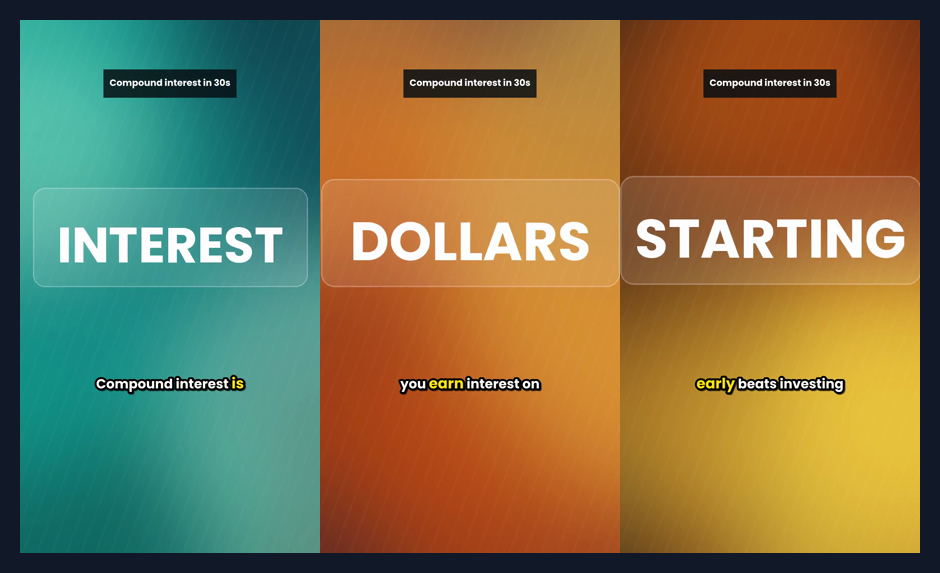
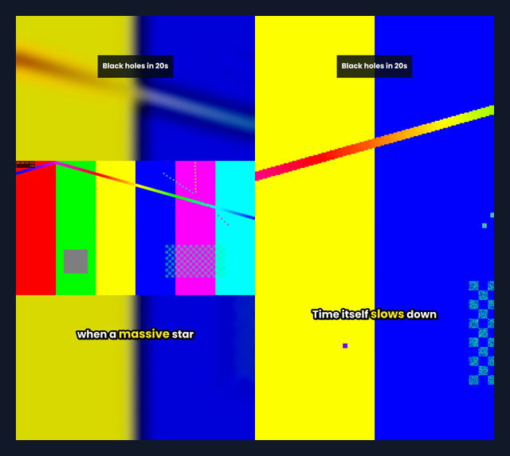
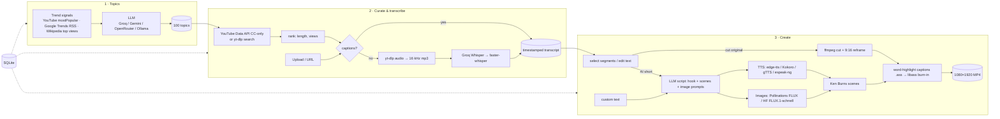

# 🎬 AI-Powered Video Content Curator

An automated pipeline that **finds trending educational topics → curates popular videos on them → transcribes them → turns any slice of a transcript (or your own text) into a new vertical short**, using only free-tier APIs and open-source models.

It ships as a **Gradio web app** (4 tabs, one per stage) and a **CLI** for headless or batch runs. All stages share one SQLite store, so you can generate topics from the CLI and cut clips in the UI.

| Generated short (text → AI voice + images + word-highlighted captions) | Clip from source video (16:9 → 9:16, two reframe modes) |
|---|---|
|  |  |

<sub>The frames above were rendered with **zero API keys**, which is why they show the offline fallbacks: procedural backgrounds instead of FLUX images, and a test-pattern source video. With keys configured, the same pipeline produces FLUX images and neural narration.</sub>

---

## How it maps to the task

| Requirement | What's implemented |
|---|---|
| **Topic generation:** 100 trending educational topics | An LLM produces 100 topics across 10 categories, generated in per-category batches so the list never truncates, then de-duplicated. Topics are **grounded in live trend signals** from YouTube "most popular" (Education and Science & Tech), the Google Trends daily RSS, and Wikipedia's most-viewed articles. Each topic has a *why it's trending* line, a search query and a hook. Exportable as CSV. |
| **Content curation and transcription** | YouTube search via the Data API, which supports a **Creative-Commons-only filter** (on by default), or via yt-dlp with no key. Results are ranked by explainer-length duration, then views. Transcription runs a cost-aware chain: existing captions first, then Groq Whisper, then local faster-whisper. Timestamps go down to the word level. You can also paste a YouTube URL or **upload your own video**. Batch mode curates the top N topics in one click. |
| **Video creation tool** | Tick transcript segments, or type custom text, then choose an output. **Cut original footage:** the selected ranges are cut, reframed to 9:16 (blurred background or crop) and given burned-in captions from the transcript timestamps. **AI re-voiced and illustrated:** an LLM rewrites the text into a hooked short-form script, each scene gets TTS narration and a generated image with Ken Burns motion, and TikTok-style word-by-word highlighted captions are added. |
| **Open-source / free-tier AI** | Every AI stage has at least two providers plus an offline fallback (see below). |
| **Deliverables** | Source, this README, a Dockerfile (works as a Hugging Face Space), CI tests. |

## Architecture



## AI tool choices

The question for each stage was what the best free option is, and what happens when it's unavailable.

| Stage | Primary | Fallbacks | Why |
|---|---|---|---|
| Text (topics, scripts) | **Groq** `llama-3.3-70b-versatile` (free tier) | Gemini `gemini-2.5-flash` → OpenRouter `:free` models → **local Ollama** (open-source) | All four expose an OpenAI-compatible `/chat/completions` API, so **one ~60-line client** covers them and providers are tried in order. JSON-mode output is parsed robustly (code fences, stray prose). |
| Trend signals | YouTube Data API `mostPopular` | Google Trends RSS, Wikimedia pageviews API (no key) | Grounds the LLM in what is popular *today* rather than in its training cutoff. Celebrity and sports noise is filtered by the prompt. |
| Video search | YouTube Data API (10k units/day free) | `yt-dlp` `ytsearch` (no key) | The API exposes `videoLicense=creativeCommon`. Repurposing footage needs a license that allows it, so CC-only is the default. |
| Speech-to-text | Existing YouTube captions | **Groq Whisper large-v3-turbo** → **faster-whisper** (open-source, CPU int8) | Cheapest first: captions cost nothing. Groq transcribes an hour of audio in seconds. faster-whisper always works offline. Audio is re-encoded to 16 kHz/32 kbps mono, so ~100 min fits under Groq's 25 MB limit. |
| Text-to-speech | **edge-tts** (free neural voices) | **Kokoro-82M** (Apache-2.0, optional) → gTTS → **espeak-ng** (open-source) → silent timed track | Natural voices with no key; fully offline options exist. The silent fallback keeps captions correctly timed, so rendering never breaks. |
| Images | **Pollinations** (FLUX, free key) | **Hugging Face Inference** FLUX.1-schnell (free credits) → procedural Pillow art | FLUX-schnell is open-weight and fast (4 steps). The offline fallback draws an abstract background with the scene's key concept, so videos still communicate meaning. |
| Rendering | **ffmpeg** + **libass** | n/a | Ken Burns via `zoompan` on a 2× upscale (avoids jitter). Captions are an `.ass` file with one event per word, so the spoken word is highlighted. Parts are concatenated with stream copy. |

## Quick start

### Local (Python 3.10+)

```bash
git clone <this-repo> ai-video-curator && cd ai-video-curator
python -m venv .venv && source .venv/bin/activate      # Windows: .venv\Scripts\activate
pip install -r requirements.txt
# ffmpeg must be on PATH:  brew install ffmpeg | sudo apt install ffmpeg | winget install ffmpeg
cp .env.example .env      # optional: add any free keys you have (see below)
python app.py             # → http://localhost:7860
```

It runs with **no keys at all**: you get the seed topic list, yt-dlp search, local Whisper, edge-tts and procedural images. For the full AI experience, add these two free keys (two minutes each):

1. `GROQ_API_KEY` from [console.groq.com/keys](https://console.groq.com/keys). It powers the LLM and Whisper.
2. `POLLINATIONS_API_KEY` from [enter.pollinations.ai](https://enter.pollinations.ai), or `HF_TOKEN`, for FLUX images.

Optionally add `YOUTUBE_API_KEY` to get trend signals and Creative-Commons-only search.

### Docker

```bash
docker build -t video-curator .
docker run -p 7860:7860 --env-file .env -v $PWD/data:/home/app/data video-curator
```

### Deploy free on Hugging Face Spaces

This README's front-matter already declares a Docker Space. Create a new Space (SDK: **Docker**) and push this repo to it:

```bash
git remote add space https://huggingface.co/spaces/<you>/ai-video-curator
git push space main
```

Add your keys under **Settings → Variables and secrets**. Note: YouTube blocks most datacenter IPs from downloading media and captions. On a hosted instance, use **upload your own video** for the transcription and clip tabs, or run locally. Topic generation and the text-to-video tool work everywhere.

## Using it

**Web UI**
1. **① Trending topics:** click *Generate topics* to get 100 rows with category, why it's trending, and a search query. *Export CSV* saves them.
2. **② Curate & transcribe:** pick a topic and click *Find popular videos*, then pick a video and click *Transcribe*. *Automate* runs this for the top N topics.
3. **③ Create a short:**
   - *From transcript:* tick segments. Non-contiguous picks become separate cuts joined in order. Then choose **Cut original footage** or **AI re-voiced & illustrated**. The selected text is editable before the AI mode runs.
   - *Custom text:* paste anything.
4. **Library:** every render with its settings, previewable.

**CLI**
```bash
python cli.py status                                  # which providers are active
python cli.py topics --n 100                          # generate + store topics
python cli.py curate --limit 10 --per-topic 2         # search + transcribe for top 10 topics
python cli.py transcribe https://youtu.be/<id>        # one video; prints numbered segments
python cli.py add-file lecture.mp4 && python cli.py transcribe local-<hash>
python cli.py clip <video_id> --segments 3-6,9 --mode original --layout blur --title "Why the sky is blue"
python cli.py clip <video_id> --segments 3-6 --mode generated --style "Flat illustration"
python cli.py text "Your paragraph..." --title "Hook" --rewrite --seconds 40
python cli.py run --topics 100 --curate 5 --clips 3   # fully automated end-to-end
```

Outputs are written to `data/outputs/`. State lives in `data/curator.db`.

## Project structure

```
app.py                 Gradio UI (4 tabs)
cli.py                 headless CLI for every stage + end-to-end `run`
curator/
  config.py            env-driven settings, provider status
  llm.py               one OpenAI-compatible client for Groq/Gemini/OpenRouter/Ollama, robust JSON parsing
  topics.py            trend signals + batched topic generation (+ seed_topics.py offline list)
  sources.py           YouTube API / yt-dlp search, ranking, downloads, local uploads
  transcribe.py        captions → Groq Whisper → faster-whisper; segment regrouping
  script.py            LLM short-form script writer + heuristic splitter
  tts.py               edge-tts / Kokoro / gTTS / espeak-ng / silent
  images.py            Pollinations / HF FLUX / procedural backgrounds
  video.py             ffmpeg rendering: Ken Burns scenes, 9:16 reframing, ASS word-highlight captions
  pipeline.py          orchestration shared by UI + CLI
  storage.py           SQLite (topics, videos, transcripts, clips)
tests/                 offline test suite (mocked LLM, real ffmpeg renders)
assets/fonts/          Poppins Bold (SIL OFL) for captions
```

## Design notes

- **Graceful degradation everywhere.** Each stage tries free, high-quality providers first and ends at something that cannot fail, such as the seed topics, local Whisper, the silent TTS track or procedural images. A missing key or a rate limit degrades quality instead of crashing the pipeline. `python cli.py status` and the UI accordion show exactly which provider is live.
- **Cheapest path first in transcription.** Existing captions → hosted Whisper → local Whisper. Results are cached per video in SQLite, so nothing is transcribed twice.
- **Licensing is part of the design.** Curation defaults to Creative-Commons videos, and every clip records its source URL and license in the library. yt-dlp results are labelled "unknown (check before reuse)". Uploading your own footage is a first-class path.
- **Captions are first-class.** Most short-form viewers watch muted, so captions are burned in with per-word highlighting. They use Whisper word timestamps when available and are otherwise distributed by word length.
- **Resumable stages.** Topics, videos, transcripts and clips are separate tables, so you can stop anywhere and continue later, from either the UI or the CLI.

## Testing

```bash
pip install -r requirements-dev.txt
pytest -q
```

The 16 tests run offline. They cover topic generation, both with a **mocked LLM** (batching, dedupe, fenced-JSON parsing) and offline; URL parsing; ranking; caption regrouping; script splitting; and ASS caption generation. They also do **real ffmpeg renders** of both modes, asserting 1080×1920 output, correct duration and multi-cut joining. CI runs them on every push via GitHub Actions.

The remote integrations (Groq, Gemini, Pollinations, HF, YouTube, edge-tts, Kokoro) follow each provider's current API documentation. They are exercised when keys are present and are not covered by the offline test suite.

## Limitations & next steps

- **YouTube on cloud hosts:** datacenter IPs are often blocked from downloads and captions. Fixes would be a residential proxy (supported by yt-dlp and youtube-transcript-api) or the upload path.
- **Smarter clip selection:** ask the LLM to rank transcript windows by "hook-iness" and auto-propose the best 30–60 s segments. A virality score could combine the topic's trend signal with that ranking.
- **Speaker / face-aware reframing:** use MediaPipe face tracking to crop toward the speaker instead of the centre.
- **Background music + ducking,** B-roll from Pexels/Pixabay free APIs, multilingual output (Whisper translation + multilingual TTS voices).
- **Job queue:** for a multi-user deployment, move rendering to a worker (RQ/Celery) and storage to Postgres + object storage.

## License

MIT for the code. The caption font Poppins is licensed under the SIL Open Font License (see `assets/fonts/OFL.txt`). Third-party videos remain under their own licenses. Check the license recorded with each source before publishing a clip.
